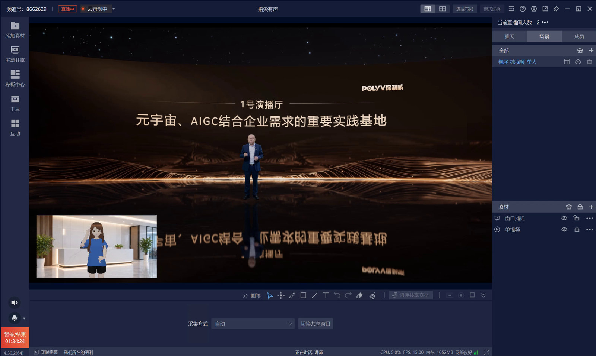
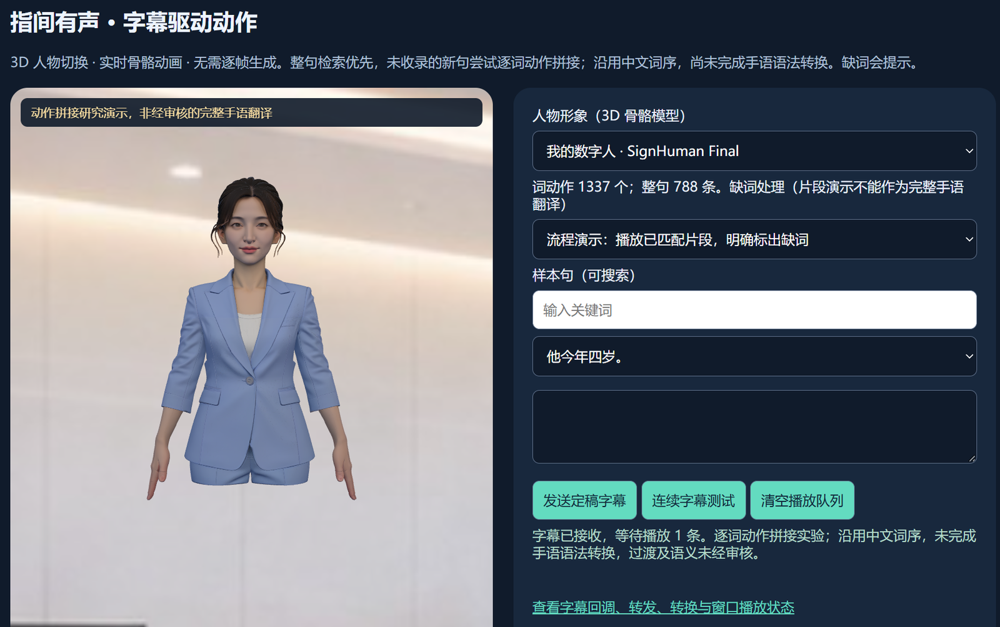
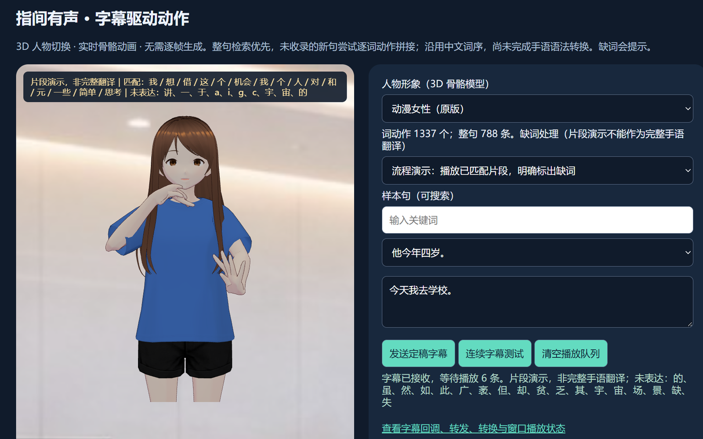
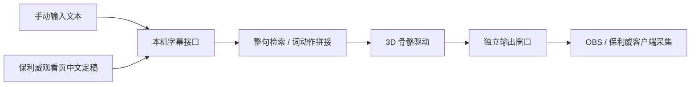
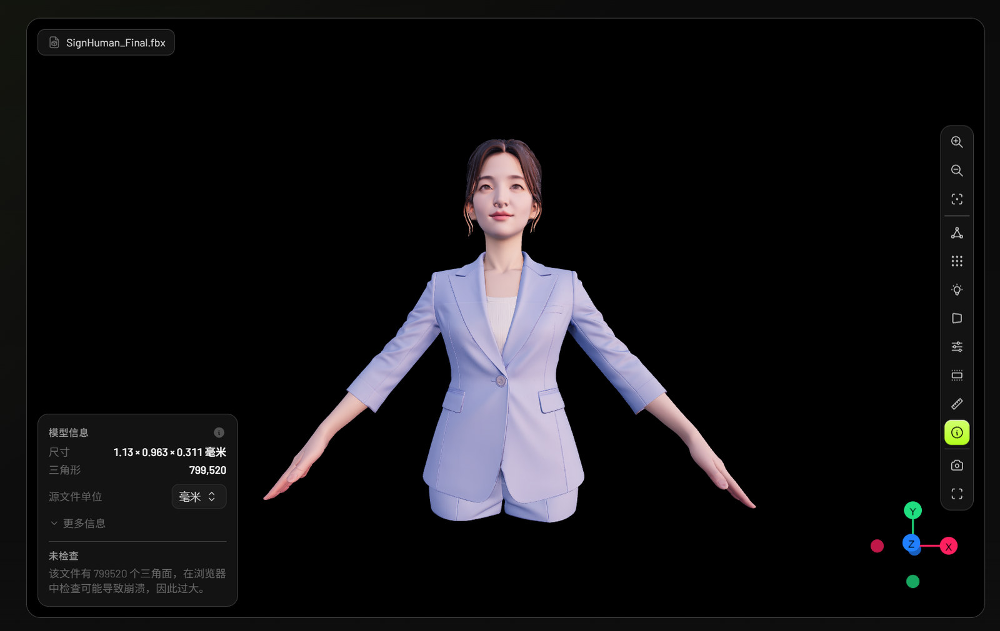
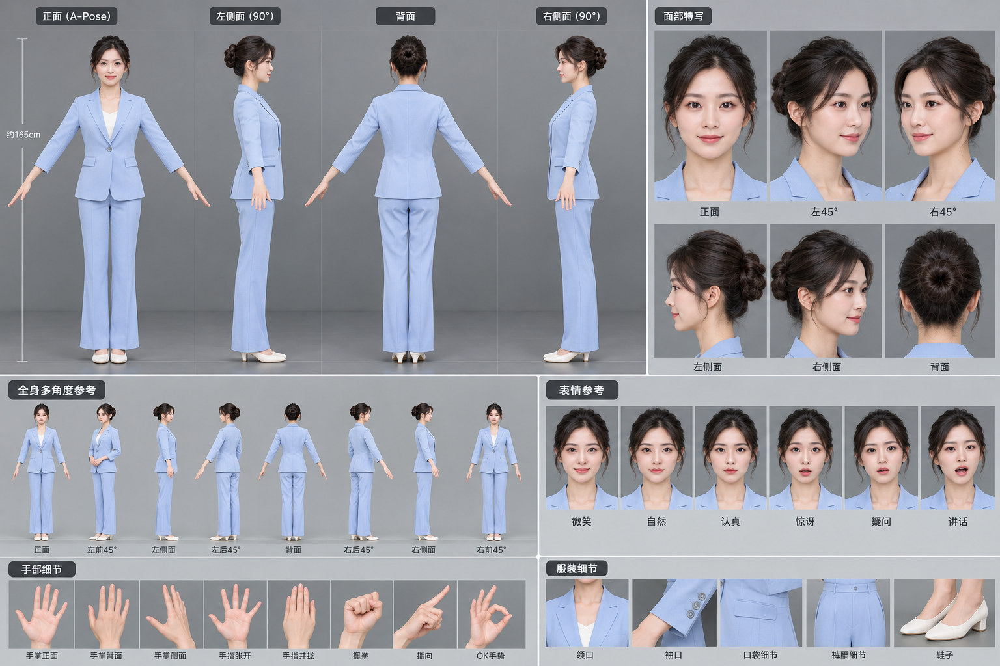

# 指尖有声 · 手语直播数字人

无声世界，指尖有声。结合保利威直播、实时字幕和 3D 手语数字人的 demo 项目，希望让听障人士有更多了解世界的机会。

本地 3D 骨骼数字人实验项目：接收输入文本或保利威直播字幕，检索手语动作并驱动人物，再由 OBS 或保利威客户端采集输出窗口。运行无需 PyTorch、CUDA 或云端照片渲染。

## 项目效果

将手语数字人作为独立窗口叠加到直播画面中，观众可以同时观看主画面、字幕和人物动作。以下图片来自项目讲解中的历史演示，界面及动作表现可能与当前代码版本不同。



### 文本驱动与人物切换

在控制页输入文本、选择人物并发送定稿字幕。已有整句优先匹配，未收录句子尝试拼接词动作；未匹配部分会提示缺词。

| 写实女性人物 | 动漫女性人物 |
| --- | --- |
|  |  |

两种形象共用字幕接入与动作检索流程。人物骨轴、静止姿态和蒙皮权重不同，需要分别校准动作重定向。

### 当前流程



### 模型与设计参考

下图为导入人物模型的预览，工程保留 FBX、Blender 源文件及运行所需的 GLB。



<details>
<summary>查看多角度与 A-Pose 设计参考</summary>

下图属于人物设计和建模参考，展示目标造型、服装与手部细节；当前实现的效果见上方运行截图。



</details>

## 快速启动（Windows）

安装 Python 3.12、Git 和 Git LFS 后：

```powershell
git lfs install
git clone https://github.com/aidown666-sys/zhijian-yousheng.git
cd zhijian-yousheng
git lfs pull
powershell -NoProfile -ExecutionPolicy Bypass -File .\setup.ps1
.\start.cmd
```

打开 http://127.0.0.1:8877/ ，输入「他今年四岁。」验证完整动作。默认形象为用户写实人物标准手部版，可切换动漫人物对照。依赖下载慢可执行：

```powershell
.\setup.ps1 -IndexUrl https://mirrors.nju.edu.cn/pypi/web/simple
```

## 直播使用

1. 在控制页配置普通游客可观看的保利威观看地址。
2. 本机接收器获取正常游客会话，连接字幕 WebSocket，并将中文定稿发送到本机动作接口。在 /diagnostics 查看接收和转换状态。
3. 双击 open-capture-window.cmd，在保利威客户端添加窗口采集。默认绿幕，可用色键抠像，控制页也支持自定义背景图。
4. OBS 可直接添加浏览器源 http://127.0.0.1:8877/output ，建议 720×720。首次加载请等待本地模型读取完成。

备用 PHP 回调拉取、配置和排障见 [保利威接入](docs/POLYV.md)。

## 实际能力

- 788 条去重句子及约 1,337 个词动作片段，优先完整句检索，其次分词拼接。
- 当前沿用中文词序，没有实现通用中文到标准中国手语的语法转换。专名和直播术语仍会缺词。
- 片段演示模式跳过未匹配部分并显示缺词；严格模式遇到缺词不播放不完整动作。片段演示不代表完整翻译。
- 手形、掌心方向、过渡及语义需手语人员审核。
- 当前适配公开、普通游客观看的保利威频道；不绕过登录、密码和付费权限。观看接口变化可能影响连接。
- 动作数据作为非商业研究私有备份；人物及依赖遵循各自许可，不声称已取得商用或公开再分发授权。

## 目录

| 路径 | 内容 |
| --- | --- |
| live_server.py | 本地 HTTP 服务、动作检索及字幕队列 |
| web/ | 控制台、3D 驱动、输出页、本地前端依赖 |
| assets/3d/user/ | 当前默认人物 GLB、校准数据和对照版本 |
| assets/3d/user/source/ | 原始 FBX、优化 FBX/Blender 工程、验证报告 |
| assets/3d/valid/ | 亚洲女性/男性示例、来源及许可 |
| assets/3d/custom*/ | 早期建模对照版本和参考图 |
| data/ | 指定研究动作库及词标注（Git LFS） |
| integrations/polyv/ | 字幕接收器、备用 PHP 中转及配置示例 |
| tools/ | 骨骼计算、Blender 优化与验证工具 |
| tests/ | 动作、协议、背景、连接恢复及安全校验 |
| docs/ | 接入、开发及资产维护说明 |
| runtime/、outputs/ | 本机缓存、日志和输出，不提交 |

## 验证

```powershell
.venv\Scripts\python.exe -m unittest discover -s tests -p "test_*.py"
node --test tests/test_hand_retarget.mjs
python tools/verify_asset_manifest.py
```

Node.js 仅用于数学回归测试，不是启动必需；PHP 测试缺少 PHP 时会跳过对应项目。

[架构与接口](docs/DEVELOPMENT.md) · [资产维护](docs/ASSETS.md) · [第三方来源](THIRD_PARTY_NOTICES.md) · [敏感配置](SECURITY.md) · [私有仓库访问](docs/COLLABORATION.md)。历史调查保留于 integrations/polyv/，当前运行方式以本文与 docs/ 为准。
